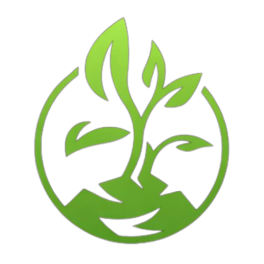
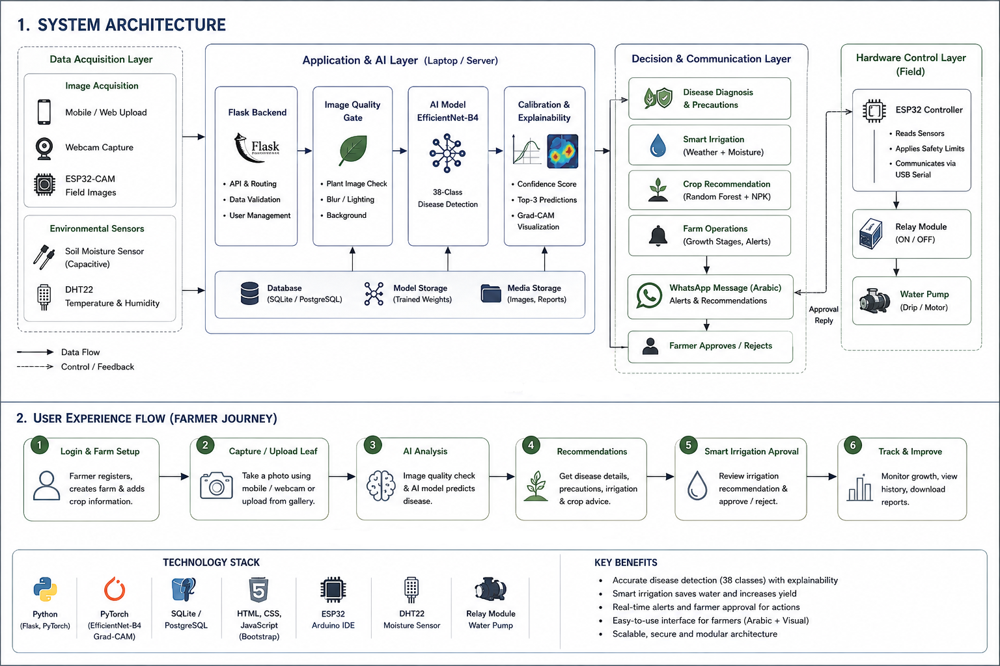
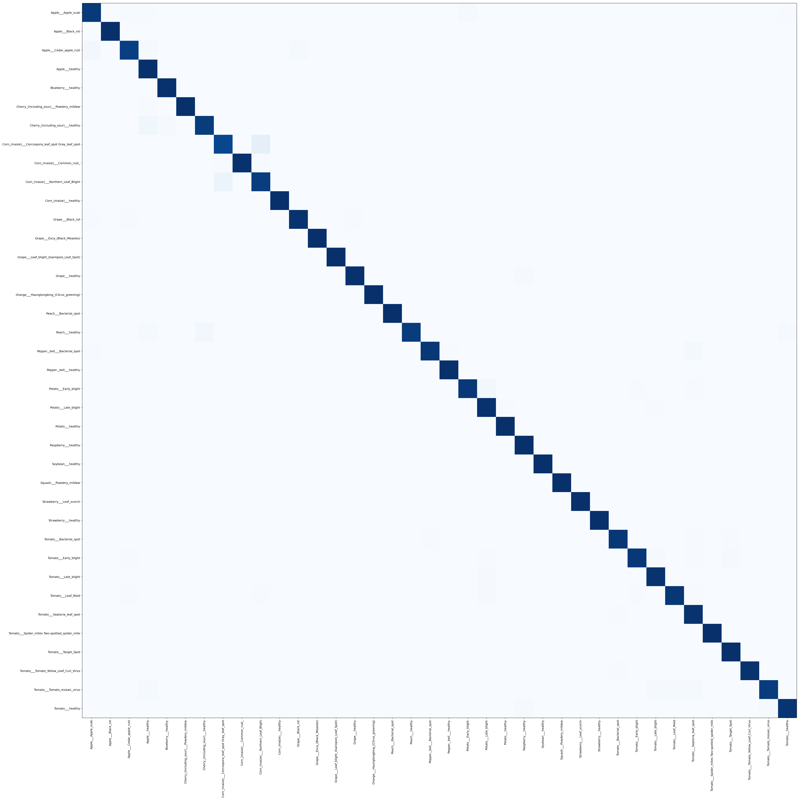

<div align="center">

<picture>
  <source media="(prefers-color-scheme: dark)" srcset="static/images/Logo_Trim.png">
  
</picture>

# PhytoSync

### AI-powered crop health and farm advisory platform

[](LICENSE)
[](https://www.python.org/)
[](https://flask.palletsprojects.com/)
[](https://pytorch.org/)
[](https://fastapi.tiangolo.com/)
[](tests/)

**Detect plant diseases from leaf images, monitor farm conditions, and turn field data into actionable agricultural guidance.**

[Quick Start](#-quick-start) · [Features](#-feature-showcase) · [Architecture](#-architecture) · [Results](#-results) · [Roadmap](#-roadmap) · [API](#-api-overview)

> [!IMPORTANT]
> PhytoSync is a prototype for local development and evaluation. Predictions and precautions are advisory and may be incorrect. Always confirm plant diagnosis and treatment with a qualified agricultural specialist.

</div>

---

## Overview

PhytoSync gives farmers and agricultural teams one accessible workspace for diagnosis and operational farm guidance. The application is split into a farmer-facing Flask platform and a standalone FastAPI image/advisory service.

The central principle is simple:

> **The image classifier is the source of truth for plant-pathology output.**
>
> Soil moisture, weather, and farm context may inform irrigation and sustainability advice, but they cannot change or overwrite a disease label.

---

## Why PhytoSync?

Traditional agricultural tools often separate diagnosis from day-to-day farm management. PhytoSync connects them:

> **Computer vision identifies a potential plant disease, while farm and environmental context support irrigation and operational decisions—without allowing contextual data to override the disease classifier.**

It is built to keep each layer auditable: users can review the image result, the advisory inputs, and the explanation trace instead of receiving a single opaque answer.

---

## Feature Showcase

### Core AI

| Area | Capabilities |
|:---|:---|
| **Leaf disease diagnosis** | Image upload, camera capture, quality checks, confidence, alternatives, precautions, and Grad-CAM support |
| **Crop recommendation** | NPK, pH, climate, soil type, fertilizer guidance, and water requirements |

### Farm Intelligence

| Area | Capabilities |
|:---|:---|
| **Smart irrigation** | Crop-stage and weather-aware rules with soil moisture, temperature, humidity, and forecast rain |
| **Farm tracking** | Farm records, growth timeline, observations, disease logs, alerts, and sustainability context |

### Farmer Tools

| Area | Capabilities |
|:---|:---|
| **Farmer community** | Questions, answers, best responses, likes, categories, and community points |
| **Reports** | PDF-oriented farm and diagnosis report views |
| **Assistant** | Offline agronomy guidance plus optional Groq-hosted chatbot responses |

### IoT

| Area | Capabilities |
|:---|:---|
| **ESP32-CAM capture** | Validated private-network image capture endpoint |

---

## How It Works

```text
┌─────────────┐    ┌─────────────┐    ┌─────────────┐    ┌─────────────┐
│   1. Capture│ -> │ 2. Analyze  │ -> │  3. Advise  │ -> │  4. Track   │
│ Leaf / ESP32│    │ Quality + AI│    │ Irrigation  │    │ Alerts / Log│
└─────────────┘    └─────────────┘    └─────────────┘    └─────────────┘
```

1. **Capture** — upload a leaf image, use the browser camera, or connect a private-network ESP32-CAM.
2. **Analyze** — validate image quality and classify the leaf with the configured PyTorch artifact.
3. **Advise** — combine crop context with weather and soil rules for traceable irrigation guidance.
4. **Track** — save observations, monitor growth and disease status, and review farm history.

---

## Architecture

### System architecture

<div align="center">
  
</div>

*Conceptual architecture and product roadmap for PhytoSync.*

The diagram presents the full product vision: image and sensor acquisition, AI analysis, transparent recommendations, farmer approval, and continuous farm tracking.

**Current implementation:** Flask platform, FastAPI advisory service, disease baseline, crop recommendation, farm operations, and private-network ESP32 capture.

**Future model direction:** EfficientNet-B4 or another field-tested backbone may replace the current EfficientNet-B0 baseline after measured validation.

---

## Key Results

<div align="center">

| 38 | 45,770 | 11,079 | 98.73% | 0.9795 | 27 |
|:--:|:--:|:--:|:--:|:--:|:--:|
| Disease/healthy classes | Training images | Validation images | Validation accuracy | Validation macro-F1 | Passing automated tests |

</div>

These metrics describe a **public PlantVillage-style validation baseline**. They are not organizer-held-out field results and do not guarantee accuracy on real-world or in-field images.

---

## Results

### Measured model results

The included baseline provides a reproducible reference point for the disease-classification workflow:

- **38** PlantVillage-style disease and healthy labels.
- **45,770** images used for training.
- **11,079** images used for validation.
- **98.73%** validation accuracy.
- **0.9795** validation macro-F1.
- Per-class metrics and raw/normalized confusion matrices stored with the checkpoint.

These are validation-split measurements, not official field-test results. The repository deliberately keeps that distinction visible so future results can be compared honestly.

### Verified platform results

The automated suite currently covers **27 passing tests** across the Flask platform and FastAPI advisory service, including:

| Area | Verified behavior |
|:--|:--|
| Image safety | Invalid images and non-plant images are rejected with actionable warnings |
| Advisory engine | Rain-aware irrigation decisions return bounded sustainability scores and a trace |
| Network safety | ESP32 capture rejects public IP addresses and accepts only private/loopback targets |
| Crop workflows | Crop recommendation, farm creation, tracking, and alert flows are exercised |
| Community | Topics, answers, and engagement flows are tested |
| Assistant | Offline guidance and optional hosted-chat error handling are tested |

### Farmer journey

1. **Set up a farm** and record crop and field context.
2. **Capture a leaf** through upload, browser camera, or an optional ESP32-CAM.
3. **Run quality checks** before model inference.
4. **Review the diagnosis** with confidence, alternatives, and precautions.
5. **Request irrigation advice** from soil, weather, and crop-stage context.
6. **Track progress** through observations, alerts, history, and reports.

The architecture intentionally separates diagnosis from irrigation logic: advice can react to farm context without changing the image classifier's label.

---

## Technology stack

| Layer | Technology |
|:--|:--|
| Web application | Flask 3, Flask-SQLAlchemy, Jinja2 |
| Image and advisory API | FastAPI, Pydantic, Uvicorn |
| Disease classification | PyTorch, TorchVision, EfficientNet-B0 |
| Crop recommendation | Scikit-learn, Pandas, NumPy |
| Database | SQLite locally; SQLAlchemy-compatible databases through `DATABASE_URL` |
| Image processing | Pillow |
| Optional assistant | Groq-compatible OpenAI Python client |
| Reporting | ReportLab, xhtml2pdf, pdfkit |
| Testing | Python `unittest`, Flask test client, FastAPI TestClient |

---

## Quick Start

```powershell
git clone https://github.com/amr-kzf/PhytoSync.git
cd PhytoSync
python -m venv .venv
.\.venv\Scripts\Activate.ps1
pip install -r requirements.txt
Copy-Item .env.example .env
python app.py
```

Open [http://127.0.0.1:5144](http://127.0.0.1:5144).

> For environment variables, local-network access, the FastAPI service, tests, and model setup, continue with the sections below.

---

## Environment configuration

| Variable | Purpose |
|:--|:--|
| `SECRET_KEY` | Flask session signing key |
| `DATABASE_URL` | SQLAlchemy database URL; SQLite is the default |
| `GROQ_API_KEY` | Optional hosted chatbot API key |
| `GROQ_MODEL` | Optional Groq model name |
| `STORMGLASS_API_KEY` | Optional Stormglass API key for live weather; profile locations are geocoded with Open-Meteo |
| `MAIL_SERVER` | Optional SMTP server |
| `MAIL_PORT` | Optional SMTP port |
| `MAIL_USE_TLS` | Enable or disable SMTP TLS |
| `MAIL_USERNAME` | Optional SMTP username |
| `MAIL_PASSWORD` | Optional SMTP password |
| `PHYTOSYNC_WEIGHTS` | Optional official model checkpoint path |
| `PHYTOSYNC_CLASS_NAMES` | Optional class-name JSON path |

Generate a persistent session key with:

```powershell
python -c "import secrets; print(secrets.token_hex(32))"
```

Add the result to `SECRET_KEY` in `.env`. The `.env` file is private and must never be committed.

Legacy environment variable names remain backward-compatible in code, while new deployments should use the current `PHYTOSYNC_*` names.

The Flask development server listens on `0.0.0.0` for local-network access. Open `http://<your-computer-local-ip>:5144` from another device on the same network, and do not expose the development server directly to the public internet.

Run the FastAPI service separately:

```powershell
python -m uvicorn fieldguard.main:app --reload --host 127.0.0.1 --port 8000
```

Interactive documentation is available at [http://127.0.0.1:8000/docs](http://127.0.0.1:8000/docs).

Run the test suite:

```powershell
python -m unittest discover -s tests -v
```

When the optional model variables are not configured, the included public PlantVillage baseline is used if available.

---

## API overview

| Method | Endpoint | Purpose |
|:--|:--|:--|
| `GET` | `/api/health` | Report service and model availability |
| `POST` | `/api/predict` | Upload and classify a leaf image |
| `POST` | `/api/advisory` | Return an irrigation action and audit trace |
| `POST` | `/api/esp32/capture` | Capture an image from a private-network ESP32-CAM |

Example prediction request:

```powershell
curl.exe -X POST "http://127.0.0.1:8000/api/predict" `
  -F "file=@C:\path\to\leaf.jpg"
```

Image uploads are limited to 8 MB and are validated as real image payloads.

```text
Leaf image
    ↓
POST /api/predict
    ↓
Quality check
    ↓
EfficientNet-B0
    ↓
Disease label + confidence + precautions
```

---

## Model and evaluation

The bundled checkpoint is a **public PlantVillage baseline**, not an official organizer or held-out field model.

The checked-in run metadata includes:

- 45,770 training images
- 11,079 validation images
- 38 disease/healthy labels
- 98.73% validation accuracy
- 0.9795 validation macro-F1
- Per-class precision, recall, and support
- Raw and normalized confusion matrices

Recorded artifacts are available in [`artifacts/public_plantvillage_baseline/`](artifacts/public_plantvillage_baseline/).

These values describe the local validation split. They do not establish field performance, calibrated confidence, or a correct treatment recommendation.

<div align="center">
  
</div>

*Normalized confusion matrix from the public baseline validation run.*

### Train or evaluate a baseline

PlantVillage data is not included and must be obtained separately under its applicable terms.

```powershell
python -m model.prepare_plantvillage `
  --source-dir C:\path\to\PlantVillage\raw\color `
  --output-dir data

python -m model.train `
  --train-dir data\train `
  --val-dir data\val `
  --output-dir artifacts\my_model `
  --epochs 5

python -m model.evaluate `
  --weights artifacts\my_model\best_model.pt `
  --class-names artifacts\my_model\class_names.json `
  --data-dir data\val `
  --output-dir artifacts\my_model\evaluation
```

For single-image inference:

```powershell
python -m model.predict `
  --image C:\path\to\leaf.jpg `
  --weights artifacts\my_model\best_model.pt `
  --class-names artifacts\my_model\class_names.json
```

Do not use a held-out test set for training or model selection.

---

## Roadmap

### ML and Data

- [ ] Add official held-out evaluation data and a versioned benchmark report.
- [ ] Calibrate confidence thresholds and publish reliability diagrams.
- [ ] Expand field-domain validation with clearly licensed, geographically diverse images.

### Platform

- [ ] Add production authentication, authorization, rate limiting, audit logs, and secure secret management.
- [ ] Add multilingual farmer guidance with reviewed Arabic and English content.
- [ ] Package the services with Docker and a documented production deployment.
- [ ] Add CI for tests, linting, dependency checks, and model-artifact integrity.
- [ ] Improve accessibility, mobile capture UX, and low-connectivity workflows.

### IoT

- [ ] Connect validated sensor ingestion, device health, freshness checks, and consent-based alerts.
- [ ] Add controlled actuator safety, approval rules, and offline/fail-safe behavior.

The roadmap distinguishes engineering improvements from model claims: a feature is not treated as production-ready until it has a reproducible test and documented limitations.

---

## Project structure

```text
PhytoSync/
├── app.py                         # Flask application entry point
├── auth.py                        # Authentication and OTP routes
├── community.py                   # Farmer community forum
├── crop_prediction.py             # Crop recommendation routes
├── crop_tracking.py               # Farm records and alerts
├── disease_detection.py           # Leaf-disease Flask routes
├── fieldguard/                    # FastAPI and advisory services
│   ├── main.py
│   ├── schemas.py
│   └── services/
├── model/                         # Training, evaluation, and prediction
├── templates/                     # Jinja2 pages
├── static/                        # CSS, JavaScript, and images
├── tests/                         # Unit and integration tests
├── artifacts/
│   └── public_plantvillage_baseline/
├── docs/
│   ├── PHYTOSYCN-Architecture.png
│   ├── confusion-matrix-normalized.png
│   ├── INTEGRATION_DECISIONS.md
│   └── WALKTHROUGH.md
├── report/                        # Model reporting
└── requirements.txt
```

Local databases, virtual environments, `.env`, scratch files, downloaded test images, and the legacy model binary are intentionally excluded from Git.

---

## Data and responsible-use notes

- The public baseline may not generalize to field conditions, uncommon crops, poor lighting, or out-of-domain images.
- Image-quality checks are heuristic and do not replace human verification.
- Model confidence is not a calibrated probability of treatment success.
- Crop-protection guidance is informational and must be checked against local extension advice and product labels.
- The Flask demo is not configured as a production multi-user deployment.
- A production deployment should use strong secrets, HTTPS, secure database credentials, authorization checks, rate limiting, logging, backups, and managed hosting.

---

## License

This project is licensed under the [MIT License](LICENSE).

Third-party datasets, assets, model weights, and documentation may be subject to separate licenses or redistribution terms.
